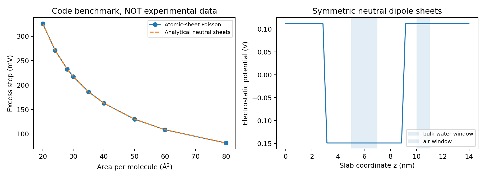
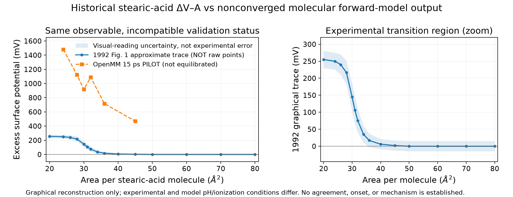
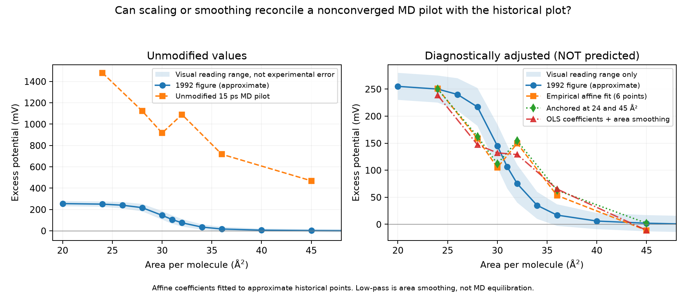

**Research status.** Theory and methods manuscript, not experimental validation. The electrostatic benchmark is tested. A subsequent short, neutral-stearic-acid explicit-water pilot was executed on 22 November 2026, but its configurations and voltages are **not equilibrated or converged**. No quantitative agreement with historical isotherms, verified mechanism, or prediction of the 30 Ų onset is claimed. See the companion [pilot quality audit](explicit_water_pilot_quality_audit.md).

## Abstract

The abrupt rise in surface potential upon compression of stearic-acid monolayers has historically been interpreted through an area-dependent effective permittivity of the polar headgroup region. A recent, substantially more molecular methodology coupled density-functional calculations and molecular dynamics to experimental surface potentials, but continued to infer effective dielectric factors and hydration contributions by regression. We instead formulate an **atom-resolved forward theory**: a molecular Hamiltonian determines equilibrium configurations at prescribed area, pH, salt activity and temperature; atomic partial charges, including explicit water and counterions, yield the excess planar charge density relative to a matched clean-water interface; Poisson's equation then predicts the electrical surface potential without a fitted dielectric jump or a fit to the potential curve. The same equilibrium ensemble can predict packing, carbonyl orientation, water hydrogen bonding, ionization and surface pressure. We provide a tested charge-density-to-voltage implementation and its analytical planar-dipole benchmark, identify the boundary-condition and reference-state requirements, and predefine falsification criteria. The **current demonstrated results** are an electrostatic forward operator and a nonconverged explicit-water execution test, **not a validated stearic-acid isotherm**. Comparison with a rough graphical reconstruction of historical measurements finds large unadjusted discrepancies; fitted scaling and area smoothing improve numerical agreement but cannot establish a physical mechanism. Independently justified force fields, equilibrated interfacial simulations and matched measurements remain necessary.

**Keywords:** Langmuir monolayer; stearic acid; stearate; interfacial electrostatics; molecular dynamics; Poisson equation; charge density; hydration; model falsification.

## 1. Why replace a successful fit?

The existing companion article in this repository constructs a lattice of packing, tilt, hydration and dissociation states, with a model-selected packing crossover near 30 Ų per molecule. It establishes **mechanistic possibility**, but not a prediction of the crossover: its packing preference and hydration fields are postulated, and the near-empirical potential magnitude follows substantial cancellation among effective dipoles. A convincing molecular model must instead derive the area dependence from intermolecular energies, geometry and thermodynamic sampling.

The 2022 work by Chachaj-Brekiesz and colleagues [1] constitutes a particularly useful methodological reference. It uses DFT-optimized conformations, molecular dynamics to obtain chain orientations and radial distribution functions to identify hydrated moieties, and a Demchak-Fort three-layer description. Its fitted relation (their Eq. 5) determines effective local permittivities, including approximately 5.00 for polar groups and 1.80 for apolar groups, and a water-related apparent dipole contribution of about -0.85 D. Those numbers describe **their fluorinated-compound family**, not stearic acid; they are *inferred*, not direct dielectric profiles from an atomically resolved Poisson calculation. The study's major advance was to incorporate molecular orientation and hydration structure into an electrical interpretation rather than assume upright rigid molecules.

The proposed stronger test is to make the experimental electric potential an **out-of-sample prediction**. Neither the onset area nor an interfacial dielectric constant is allowed to be chosen by matching its shape. The unknown is whether a plausible, independently specified intermolecular Hamiltonian reproduces the curve after converged equilibrium sampling. Earlier atomistic treatments of neutral stearic acid and charged stearate [2-5] mean that the novelty to pursue is not 'first molecular simulation', but systematic closed-loop, area-series forward prediction with matched electrostatic references, pressure constraints, robust charge regulation, and held-out perturbations.

## 2. The physical observable is a difference between two interfaces

Define a consistent surface-normal coordinate $z$ (water to air positive) and the potential of the adjacent air plateau relative to the bulk-water plateau in a single simulation, $V=\phi_{\mathrm{air}}-\phi_{\mathrm{water}}$. The experimentally relevant change, subject to matching the instrument's sign convention, is

$$
\boxed{\Delta V(A,T,{\mathrm{pH}},I)=V_{\mathrm{film}}(A,T,{\mathrm{pH}},I)-V_{\mathrm{clean}}(T,{\mathrm{pH}},I).}
\tag{1}
$$

**The clean-water subtraction is not optional.** Microscopic water-interface potentials depend strongly on model-specific molecular multipoles and definitions of the electrostatic reference. Comparing an isolated model-film potential directly to a vibrating-plate/Kelvin-probe change would conflate two different observables. The film and clean references should share the water model, ion parameters, electrostatic convention, sufficiently comparable slab geometry and temperature. If the force field changes with protonation, those charge models must remain internally compatible.

For a planar homogeneous interface, the ensemble-averaged total charge density is

$$
\bar\rho_A(z) = \left\langle \frac{1}{L_xL_y}\sum_{i=1}^{N_{\mathrm{atom}}}q_i\,\delta(z-z_i)\right\rangle_{A,T,\mu},\quad
\frac{d^2\phi}{dz^2}=-\frac{\bar\rho_A(z)}{\epsilon_0}.
\tag{2}
$$

Here **every charged atomic site, explicit water and counterion** contributes. For a neutral, isolated planar charge distribution with vanishing field on both sides, integration yields

$$
V_{\mathrm{air}}-V_{\mathrm{water}}=\frac{1}{\epsilon_0}\int_{z_{\mathrm{water}}}^{z_{\mathrm{air}}}z\,\bar\rho(z)\,dz
\quad\text{(when the integration region contains a neutral interface).}
\tag{3}
$$

Equation (3) is *not* valid if an isolated integration window contains net surface charge and its compensating diffuse countercharge lies outside the window. For ionized films, use the **whole neutral charge distribution and the actual electrostatic boundary condition**, not a naïve sum of separate charged group dipoles. An equally important consequence is that **an explicit-ion, all-charge Poisson calculation already includes the diffuse-layer electrostatics**. Adding a Gouy-Chapman term to it a second time would double-count that contribution.

When a fully periodic, charge-neutral, symmetric two-sided slab is used, the corresponding periodic planar Poisson solution is convenient:

$$
\widetilde\phi(k_z)=\frac{\widetilde\rho(k_z)}{\epsilon_0 k_z^2}\;(k_z\ne0),\qquad
\widetilde\phi(0)=0.
\tag{4}
$$

Only differences between *verified bulk-water and adjacent-air plateaus* are reported. A symmetric slab permits a flat air region on either side when total normal dipole cancels. Nonzero net slab dipoles, asymmetric slab arrangements, three-dimensional Ewald artifacts, slab corrections and conducting-boundary conditions require separate analysis; the simple periodic inversion is not a universal replacement for the electrostatics used by the dynamics engine.

## 3. A genuinely molecular statistical-mechanical model

Instead of prescribing a condensed fraction $\phi(A)$ or an orientational field $B_e(A)$, let $\mathbf R$ include the coordinates of **individual stearic-acid/stearate atoms, water atoms and ions**, with headgroups and chain torsions free to fluctuate. At a fixed molecular area $A=S/N_s$ (where $N_s$ counts molecules *per interface*), one possible canonical model is

$$
Z(A,T;\mathbf n)=\int_{\mathcal C(A,\mathbf n)}d\mathbf R\,\exp[-\beta U_{\mathrm{ff}}(\mathbf R,\mathbf n;S,L_z)] ,
\quad F=-k_BT\ln Z,
\tag{5}
$$

with chemically specified bonded, torsional, dispersion, Coulomb and optional polarization terms in $U_{\mathrm{ff}}$. $\mathbf n$ denotes protonation and ion composition. A semi-grand, constant-pH treatment would sum states with appropriate chemical potentials and **explicitly neutral charge bookkeeping**; simply sampling stearate without counterions is not acceptable. Neither effective headgroup permittivity nor the observed onset $A_c$ occurs as an adjustable piecewise input in Eq. (5).

The key microscopic consequence is that the normal electrostatic moment becomes **an emergent equilibrium average**, not a fitted function of area:

$$
\mu_{\mathrm{excess}}(A)=\frac{S\epsilon_0}{N_s}\,\Delta V(A)
\quad\text{for the neutral-localized dipole limit only.}
\tag{6}
$$

More generally the full Poisson solution, Eq. (2) or (4), is authoritative, especially when ions or long-range water polarization preclude the localized-dipole approximation. In the idealized localized, neutral limit a constant $\mu_{\mathrm{excess}}$ gives $\Delta V\propto A^{-1}$. Consequently **geometric compression alone cannot account for an abrupt onset after an extended near-zero regime**. An actual onset requires an area-dependent interfacial charge distribution, potentially because of molecular coverage heterogeneity, correlated chain and headgroup rearrangements, first-shell water response, ionization or domain nucleation.

The surface-pressure constraint offers an independent thermodynamic cross-check. At fixed $N_s,T$ and compatible chemical potentials, for **one interface**, with $\Delta F_1=F_{\mathrm{film},1}-F_{\mathrm{clean},1}$ and area $S=N_sA$,

$$
\pi=\gamma_{\mathrm{clean}}-\gamma_{\mathrm{film}}
=-\left(\frac{\partial \Delta F_1}{\partial S}\right)_{N_s,T,\mu}
=-\frac{1}{N_s}\left(\frac{\partial \Delta F_1}{\partial A}\right)_{N_s,T,\mu}.
\tag{7}
$$

In a symmetric two-interface slab the total excess free energy includes *both* interfaces, so it must be divided by two before applying Eq. (7), with bulk and finite-size contributions handled consistently. Free energies include appropriate reference terms and surface conventions. A force field that predicts $\Delta V(A)$ but fails to predict or accommodate the measured $\pi(A)$ and known phase state remains physically suspect.

## 4. Microscopic hypotheses and non-circular discriminators

We distinguish three nonexclusive hypotheses that generate different co-observables, rather than tune them until the same voltage curve emerges.

**H1, hydration reorganization.** Compression alters headgroup-water and lateral water hydrogen bonds, the occupancy and orientational profile of the first hydration shell, and the depth-resolved water charge density. Predicted signature: a change in $\Delta\rho_{\mathrm{water}}(z)$ and water orientation coinciding with the potential rise even after conditioning on chain tilt and charge state. This is related to the molecular mechanism conjectured in the historical interpretation, but is not established by it. A charge-density partition on unchanged snapshots is descriptive; causal testing demands controlled force-field or state perturbations that preserve a physically valid ensemble.

**H2, headgroup and tail conformational reorganization.** Chain tilt, gauche defects, carbonyl orientation and carboxyl rotamers vary with area. Predicted signature: independently measurable changes in C=O orientation and GIXD/IRRAS-derived tilt, correlated with the organic-atom electrostatic profile. A sharp rise may occur without a comparably sharp water structural signature.

**H3, charge regulation and ion redistribution.** Surface protonation depends on pH, local ion environment, packing and solvation; counterion and coion profiles create a distributed double layer. Predicted signature: shifts of the voltage curve with salt and pH that track directly estimated deprotonation and ion profiles. This hypothesis must be tested with a charge-regulated ensemble, not a post-hoc diffuse-layer offset added to an already explicit-ion calculation.

The hypotheses can coexist and can compensate electrostatically. A rise in $\Delta V$ alone is insufficient to decide among them. A discriminating dataset should simultaneously constrain structure, hydration and charge as well as voltage.

## 5. Practical simulation specification

A minimally credible computational experiment consists of a systematic series over **$A=20$ to $80\,\mathring{\mathrm A}^2$ per acid molecule** (with denser points around 25-35 Ų), plus matched clean-water controls and selected salt/pH conditions. This area interval is a proposed design, not a claim that all states form uniform stable monolayers: expanded states may contain islands, and initial configurations must be allowed to nucleate or disperse without forcibly maintaining uniform packing.

1. **Force field.** Choose and document a chemically compatible all-atom stearic-acid/stearate model, ion parameters and explicit water model. Derive any missing carboxyl parameters independently of the electrical isotherm (e.g., quantum-chemical conformers, solvation and hydration observables), compare at least two plausible water/charge models, and, if feasible, benchmark headgroup dipole response with polarizable or first-principles methods. Do not silently mix OPLS, CHARMM and GAFF parameters.
2. **Interface.** Build a **neutral, symmetric two-sided water slab**, with neutral/ionized acid films on both sides, matched molecules per interface, sufficient bulk water and vacuum plateaus, periodic lateral boundaries and documented long-range electrostatics. Increasing the lateral size must not move the apparent onset substantially. Assure both surfaces represent the same thermodynamic state before averaging.
3. **Ensemble.** At each fixed lateral area, equilibrate independent replicas from dilute, condensed, and randomized initial distributions. Record box dimensions and ensemble variables. Assess metastability, phase segregation, domain coarsening, tilt, and torsional relaxation; a compressed single trajectory may trap its initial arrangement and falsely create an onset.
4. **Ionization.** Initially run neutral COOH films under deliberately acidic conditions, then treat dissociation with a validated constant-pH / semigrand method or explicitly enumerated and correctly charge-compensated compositions. Vary pH and salt independently. Ionic strength and effective protonation of the actual subphase must be reported.
5. **Measurements.** Export coordinates **and site charges of all atoms and ions per frame**, box dimensions and molecule identities. Verify charge neutrality for every frame. Align the water slab in $z$ before computing time averages; incorrectly wrapped molecules or translating slab interfaces will smear $\rho(z)$. Calculate $\Delta V$ only after documenting the plateau locations and boundary correction. Estimate uncertainty by independent replicas and autocorrelation-aware blocks, not treating every MD time step as independent.
6. **Structural diagnostics.** Collect carbonyl angle distributions, chain tilt/gauche statistics, headgroup hydration number, O--H and O--O radial distributions, interfacial water orientation and hydrogen bonding, domain size and structure factors, ion density, deprotonation fraction, and surface pressure. Compare with independent spectroscopy and scattering where available.
7. **Experimental comparison.** Specify the reference data's pH, salt, T, compression rate, potential measurement convention and raw uncertainty. Establish train/holdout separation **before** seeing potential data. A physically calibrated force field can be assessed against potential curves; do not readjust $A_c$, dielectric factors or headgroup charges to make each potential curve agree.

The 2022 paper [1] reports surface-potential accuracy of approximately $\pm 15$ mV and area accuracy of $\pm 2\,\mathring{\mathrm A}^2$ for its particular fluorinated systems. These uncertainties are useful as methodological scale, **not** a substitute for stearic-acid measurement errors. The preliminary numerical convergence target of roughly 10 mV is a design criterion only.

## 6. Implemented forward operator and input contract

A new `src/isotherms/atomistic.py` module implements a one-dimensional, periodic, planar Poisson solver. It deposits each atomic partial charge to neighboring $z$ bins by cloud-in-cell assignment; transforms the planar charge density by FFT; solves $\widetilde\phi=\widetilde\rho/(\epsilon_0k^2)$ for nonzero wave number; and extracts the plateau potential difference. For the neutral symmetric slab, this agrees with the analytic electrostatics of two mirrored dipole sheets. No local dielectric constant or voltage-scale calibration appears in the code.

The executable `scripts/atomistic_forward.py` reads *two separate* NPZ files, one for the full film and one for the clean-water reference. Required arrays are `z_nm` (frames by atoms), `charges_e` (atoms, or frames by atoms), and a fixed `box_nm=[Lx,Ly,Lz]` vector in nanometers. A charge-changing trajectory must maintain neutrality in **every frame**; fixed-area ensembles are assumed. The model explicitly rejects nonneutral snapshots and mismatched film/reference boxes. For example:

```bash
PYTHONPATH=src python scripts/atomistic_forward.py \
  --film film_A30.npz --clean water_A30.npz \
  --water 5 7 --air 10 11 --bins 2048 --out results/atomistic_A30
```

The $z$ windows are *examples*, **not** coordinates to reuse blindly in real molecular trajectories. They must lie in flat bulk-water and adjacent-air regions appropriate to the actual slab. The resulting profiles and excess voltage are saved to CSV for independent inspection. A checker for instantaneous force-field charge neutrality is included; deciding whether slab electrostatics and sampling are physically appropriate remains a research responsibility. This small analysis code does **not** itself perform molecular dynamics, constant-pH sampling, force-field parameterization, or electrostatic slab corrections.

## 7. Numerical experiment: exact neutral-sheet benchmark

We first test the electrostatic machinery against a system with a known answer rather than manufacture agreement with the stearic-acid data. Each side of a symmetric water-slab geometry is represented by 64 charge-neutral dipoles with charges $\pm0.012e$ separated by $d=0.30$ nm. These are **synthetic effective point-charge sheets, not stearic-acid or water molecules**. For the upper interface,

$$
V_{\mathrm{sheet}}(A)=\frac{qed}{\epsilon_0 A}\qquad
(q=0.012,\; d=0.30\;\mathrm{nm}),
\tag{8}
$$

where $A$ is area per dipole and the two mirror-oriented sheets remove the net slab dipole. The resulting apparent moment per upper-site dipole is $\mu=0.173$ D. At $A=20\,\mathring{\mathrm A}^2$, Eqs. (4) and (8) give approximately **0.3257 V**; at $A=40\,\mathring{\mathrm A}^2$ approximately **0.1629 V**. The FFT solver and analytic result agree to floating-point precision for the tested points with bins and plateaus used. This validates only the electrostatic implementation in the idealized case.



The smooth $1/A$ response explicitly **fails to generate** the historical onset, illustrating why emergent molecular rearrangement is necessary. The synthetic figure does not contain experimental measurements, force-field water or stearic-acid simulation.

The regression-free check is distributed as `tests/test_atomistic.py` (eight tests; charge conservation, neutrality rejection, analytic dipole-sheet limit, inverse-area scaling, coordinate order/periodic translation invariance, clean-water subtraction and incompatible-grid rejection) and `examples/atomistic_sheet_benchmark.csv`. These validations establish that the numerical operator works on controlled cases; they are **not a molecular mechanism validation**.

## 8. Why the apparent permittivity remains useful but not primary

The Demchak-Fort representation,

$$
\Delta V_{\mathrm{DF}}(A)=\frac{1}{\epsilon_0 A}\left[
  \frac{\mu_{\mathrm{w}}}{\epsilon_{\mathrm{w}}}+
  \frac{\mu_{\mathrm{p}}}{\epsilon_{\mathrm{p}}}+
  \frac{\mu_{\mathrm{a}}}{\epsilon_{\mathrm{a}}}
\right]+\psi_0,
\tag{9}
$$

provides useful phenomenological bookkeeping, especially with independently constrained molecular orientations as in [1]. The obstacle to treating its fitted parameters as microscopic material constants is that a thin interface is anisotropic, inhomogeneous and sensitive to the separation into 'head', 'water' and 'tail' regions. A fitted $\epsilon_{\mathrm{p}}$ can absorb molecular conformer populations, orientational correlations, displaced water, induction and charge regulation. In Eq. (2) all charged sites contribute directly, and those microscopic effects emerge from their distribution given a specified Hamiltonian.

A second-stage *projection* could derive an **effective** Demchak-Fort representation from fully computed $\Delta V$ profiles for transparent comparison with [1], but those dielectric factors would be outputs, not parameters used to generate the primary predicted isotherm. This hierarchical relationship avoids a misleading choice between molecular simulations and useful coarse-grained electrical descriptors.

The organic/water/ion decomposition is also delicate: integrated dipoles of charged subgroups are origin dependent. If one evaluates restricted partial-charge profiles, their individual potential steps can depend on charge compensation and gauge even when the total does not. We therefore regard the full neutral-system voltage as the primary physical result and any partition into contributions as a diagnostic requiring a declared convention. Deleting water charges from already sampled frames is a descriptive counterfactual, not a thermodynamically equilibrated 'without hydration' experiment.

## 9. What would count as evidence for the molecular mechanism?

The primary result should be a **blind prediction of $\Delta V(A)$ together with $\pi(A)$**, using molecular parameters fixed from independent observables. The ability to reproduce one curve after adjusting water or headgroup charges to the same curve would not satisfy this criterion. Minimum discriminators are:

- **Location and sharpness.** The calculated onset (if any) lies near the experimental transition within independently measured uncertainties, with no parameter chosen to place it there.
- **Charge-neutral acidic control.** Neutral COOH simulations predict a reproducible potential-area response without using a fitted diffuse-layer offset. A failure here cannot be excused by freely tuning ionization.
- **Held-out pH and salt.** The same model predicts direction and approximate scale of changes in voltage, adsorption structure and ionization without re-parameterizing across conditions.
- **Joint structure.** The region of strongest predicted electrical change is supported by independent tilt, spectroscopic hydration or scattering observables; the role of water, headgroup and charged layers is consistent with the computed full charge density.
- **Numerical robustness.** Replica/block and lateral-size uncertainties do not cover or move away the claimed onset; the clean-water reference and boundary convention yield stable plateaus. Competing plausible force fields should expose the actual model dependence.

A well sampled ensemble with no sharp electrical response, a wrong sign, incorrect ionic dependence, or an incompatible phase/pressure curve would *reject or constrain the proposed microscopic account*, rather than imply that an effective dielectric discontinuity must be inserted by hand. The particularly informative result might be a **negative** one: force fields that fit structural isotherms yet cannot predict the observed potential would pinpoint missing polarization, protonation chemistry or interfacial boundary physics.

## 10. Scientific status and next computational milestone

This work makes one decisive conceptual change relative to the existing lattice model: it specifies the potential as an observable **generated from microscopic charge configurations**, not as a sum of adjustable effective molecular dipoles. The accompanying solver is independently testable, and the simplest physical constraint, the $1/A$ dipole-sheet law, is exactly recovered. The 2022 reference strongly supports the importance of molecular tilt and hydration analysis but does not establish that the stearic-acid onset is caused primarily by water reorganization.

**What has been achieved:** a microscopic forward formulation, explicit reference conventions, tested electrostatic analysis code, an analytic benchmark, and a short explicit-water MD pipeline with matched clean-water controls at 24, 28, 30, 32, 36 and 45 Ų/molecule. The latter is a numerical smoke test, not an equilibrium calculation.

**What has not been achieved:** *converged* atomistic sampling, validated force-field transferability, a surface-pressure isotherm $\pi(A)$, a quantitative predictive electrical isotherm or agreement with measurements. Ten production frames per area fluctuate by roughly 0.18-0.56 V (sample standard deviation); the nominal water plateaus are not flat. These values are diagnostics, **not error bars** or physical uncertainty estimates. Raw files and checks are described in the companion audit.

The next decisive deliverable is a **convergence-tested** neutral-stearic-acid simulation at several areas, with independent seeds, larger lateral cells, validated electrostatic plateaus, block uncertainties, a surface-pressure calculation, and structural observables for headgroup orientation, hydration and chain tilt. Only then should constant-pH speciation, salt and polarizable force fields be compared systematically. This is the difference between a functioning pipeline and a predictive molecular theory.

## 11. Direct historical comparison: exploratory benchmark, not validation

The central experimental benchmark is now available. Figure 1 of Oliveira Jr., Taylor and Morgan (1992) [2] gives measured stearic-acid surface potential on ultrapure water. Its original experiment rises from near zero in the expanded regime to approximately 0.25-0.27 V on compression toward 20 Ų/molecule, with a rapid onset near 30-40 Ų. Because raw numbers were not available, we recorded only an explicitly **approximate visual trace** of the scanned published graph, not individual laboratory measurements. The associated reading bands indicate graphical interpretation precision, not experimental uncertainty.

The unmodified atomistic pipeline's six short-run values are overlaid with this historical trace. **No model parameter has been tuned to these points, but the pilot is not converged or chemically matched.** The reported MD values are approximately 1.48, 1.12, 0.92, 1.09, 0.72 and 0.47 V at 24, 28, 30, 32, 36 and 45 Ų/molecule, respectively. At 30 Ų, the historical graphical trace is approximately 0.145 V; the absolute discrepancy is roughly 0.77 V. This numerical discrepancy must not be interpreted as a calibrated model error. The pilot uses neutral molecules and just 5 ps equilibration + 10 ps production, whereas the historical subphase includes weak dissociation; different sampled states, interfacial fields and inadequate bulk-water plateau stability further prevent a rigorous comparison.



The left panel uses a common voltage scale for historical and MD values. The right panel expands the historical transition region. **This benchmark currently fails as a predictive validation test**: it reveals substantial numerical mismatch and no convergence evidence, not a reproduced molecular onset. The objective for a subsequent publication is the same plot with original observations, replicated and equilibrated molecular uncertainty bands, chemically matched conditions, independently validated electrostatic plateaus, and a simultaneously predicted surface-pressure isotherm. The full provenance, approximate trace and reproducible code are documented in [`historical_benchmark.md`](historical_benchmark.md); Section 12 examines why post-hoc scaling and smoothing do not resolve this mismatch.


## 12. What scaling and smoothing reveal, and why they do not reconcile the mechanism

The six available molecular areas also permit a **diagnostic**, but not physical, comparison of the effects of baseline correction, amplitude scaling and area-domain smoothing. Here the reference values are a **rough reading of the 1992 published figure**, not raw laboratory observations, and the simulated values are a single nonconverged 5 ps equilibration + 10 ps production pilot. The experimental subphase and the fixed-neutral-acid simulation are not chemically matched. Consequently none of the following discrepancies or fit statistics estimates a validated molecular-model error.

Without adjustment, the root-mean-square difference over six overlapping areas is **882 mV**. Ordinary least squares against these *same six historical graphical values* gives

$
\Delta V_{\mathrm{affine}}(A)
= 0.259045\,\Delta V_{\mathrm{pilot}}(A)-132.555\,\mathrm{mV},
\tag{10}
$

where both potentials in the gain term are in the same voltage units. The resulting **in-sample** RMSE is **44.9 mV** ($R^2=0.773$), but leave-one-area-out refitting increases RMSE to **57.3 mV**. Even calibrating only at the two endpoints (24 and 45 Ų) gives **45.6 mV** across the six points. These numbers describe the flexibility of a two-parameter affine transformation, **not** predictive molecular accuracy or an independently measured dielectric correction. The approximate graphical trace also has no independently established experimental uncertainties on which to base inferential significance.

Applying a Gaussian low-pass **over molecular area** with illustrative width $\sigma_A=2\,\mathring{\mathrm A}^2$, while holding the already fitted affine coefficients fixed, reduces the in-sample RMSE further to **42.0 mV**. This is a small numerical improvement relative to the uncontrolled fluctuations in the pilot, and it is not temporal low-pass filtering of an MD trajectory, thermodynamic averaging, or a sampling method for previously absent states. Smoothing may conceal an onset or manufacture a smoother interpolation; it cannot explain a molecular phase change. In particular, the *unmodified* pilot increases from **917 to 1090 mV** between 30 and 32 Ų, while the historical trace decreases from approximately **145 to 75 mV**. No positive affine gain plus offset can reverse this local slope disagreement.

{width=88%}

A physically defensible reconciliation would instead derive any instrumental or slab-reference offset from independent electrostatic-convergence tests, any change in polarization response from separately validated force fields or electronic-structure calculations, and any spatial averaging from an equilibrium phase-coexistence model whose fractions are constrained by $\pi(A)$ and structural measurements. The present pilot has only 16 molecules per interface, unresolved long-time hydration and packing relaxation, unstable bulk-water potential plateaus, and fixed protonation. **No satisfactory quantitative molecular explanation of the measured isotherm has therefore been demonstrated by the present calculations.** The appropriate next result is a converged, chemically matched *unscaled* $\Delta V(A)$ prediction with uncertainty and an independently predicted $\pi(A)$, not an optimally transformed six-point curve. Source data, parameter diagnostics and reproducible plots are provided in the companion [reconciliation diagnostic](reconciliation_diagnostic.md) and its [Python implementation](../scripts/reconciliation_diagnostic.py).


## References

1. A. Chachaj-Brekiesz, J. Kobierski, R. Griñón Echaniz, A. Wnętrzak and P. Dynarowicz-Łątka, 'Comprehensive Approach to the Interpretation of the Electrical Properties of Film-Forming Molecules', *J. Phys. Chem. B* **126** (2022), 7037-7046. <https://doi.org/10.1021/acs.jpcb.2c04526>.
2. O. N. Oliveira Jr., D. M. Taylor and H. Morgan, 'Modelling the surface potential-area dependence of a stearic acid monolayer', *Thin Solid Films* **210/211** (1992), 76-78. <https://doi.org/10.1016/0040-6090(92)90172-8>.
3. A. F. de Moura, O. N. Oliveira Jr. and M. Trsic, 'The Origins of the Surface Potential of a Stearic Acid Langmuir Film Investigated by Means of Molecular Dynamics Simulations', 2005 conference abstract, XIII SBQT. <https://marcia.iqm.unicamp.br/SBQT13.pdf>. Reports a serious potential-amplitude discrepancy in their atomistic study.
4. 'Structure and dynamics of water at liquid-vapour interfaces covered by surfactant monolayers of neutral stearic acid and charged stearate ions', *Journal of Molecular Liquids* (2008). <https://doi.org/10.1016/j.molliq.2008.01.006>.
5. 'Molecular Dynamic Studies on Langmuir Monolayers of Stearic Acid', *Chemical Research in Chinese Universities* (2013). <https://doi.org/10.1007/s40242-013-2301-x>.
6. R. J. Demchak and T. Fort Jr., 'Surface dipole moments of close-packed un-ionized monolayers at the air-water interface', *J. Colloid Interface Sci.* **46** (1974), 191-202. <https://doi.org/10.1016/0021-9797(74)90002-2>.
7. D. M. Taylor and G. F. Bayes, 'Calculating the surface potential of unionized monolayers', *Phys. Rev. E* **49** (1994), 1439. <https://doi.org/10.1103/PhysRevE.49.1439>.
8. OpenMM User Guide, v8.6, force fields and simulation setup. <https://docs.openmm.org/latest/userguide/application/02_running_sims.html>. Software documentation, not evidence of this article's simulation results.