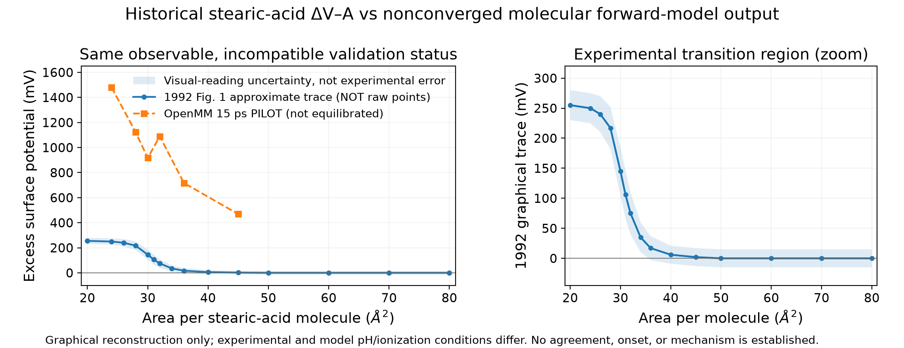

# First historical benchmark: original experimental figure versus explicit-water forward output

**22 November 2026. Status: diagnostic comparison, NOT validated molecular prediction.**

## What is compared

The experimental reference is Figure 1 on page 77 of Oliveira Jr., Taylor and Morgan, *Thin Solid Films* **210/211** (1992), 76–78, doi:[10.1016/0040-6090(92)90172-8](https://doi.org/10.1016/0040-6090(92)90172-8). The original scan was inspected. The experiment depicts stearic acid on an ultrapure-water (UPW) subphase; the authors report pH ≈ 5.6, effective monovalent electrolyte concentration 2.5 × 10⁻⁶ M, temperature 295 K, and degree of dissociation ≈ 0.002 in their theoretical treatment. The figure shows an onset around 30–40 Ų per molecule and roughly 0.25–0.27 V near 20 Ų. The experimental points themselves were **not** supplied as a tabulation.

The file [`../data/oliveira_1992_fig1_approximate_trace.csv`](../data/oliveira_1992_fig1_approximate_trace.csv) is **a manually approximated graphical trace**, not the original measurements or a precise extraction of individual symbols. The `reading_uncertainty_mv` values quantify only approximate visual reading precision of the small printed figure; **they are not experimental error bars**. The trace is suitable for a first visible comparison and qualitative diagnosis, not quantitative claims of model accuracy, curve fitting or estimation of a critical onset area.

The computational comparator is the existing *unadjusted* OpenMM output from [`../results/explicit_water_pilot/summary.csv`](../results/explicit_water_pilot/summary.csv) generated by `scripts/explicit_water_pilot.py`: neutral stearic acid (no dynamic dissociation), fixed charge OpenFF 2.2.1/TIP3P, 16 acids per side, a 5 ps equilibration interval followed by 10 ps production, one random seed for each area, and independent clean-water control. These are **not matched experimental chemical states**, nor converged molecular ensembles.



The left panel displays both on exactly the same molecular-area and voltage scales. The right panel magnifies the historical experimental signal. The apparent 30 Ų feature in the graphical trace is not a model input and **was not fitted in the atomistic solver**; however, the MD results are too short and unstable to assess whether a physical transition occurs.

## Observed numbers and interpretation

| Area (Ų/molecule) | Historical trace, approximately (mV) | MD pilot, upper/lower mean (mV) |
|---:|---:|---:|
| 24 | 250 | 1480 |
| 28 | 217 | 1123 |
| 30 | 145 | 917 |
| 32 | 75 | 1090 |
| 36 | 17 | 717 |
| 45 | 2 | 469 |

No calibration, vertical offset, rescaling, parameter optimization or empirical curve-fitting was performed. A difference of ~772 mV at A=30 Ų, much larger than visual reconstruction uncertainty, is numerically unambiguous, **but it is not a reliable model-error estimate** because of the sampling and chemical-condition mismatch. The two pilot film sides differ by ~43–123 mV, and estimated framewise fluctuations exceed ~0.18 V. Even the clean reference's would-be bulk-water plateaus are not satisfactorily flat. No surface-pressure isotherm, replica uncertainties, independent water model, or force-field benchmark exists yet.

The experiment demonstrates the qualitative target: near-zero potential over expanded areas followed by a sharp positive rise under compression. The current **unconverged** calculation does not demonstrate that behavior. It also does not disprove any specific molecular hypothesis: initial configuration relaxation, hydration structure, polarizability, protonation, finite-size effects and electrostatic slab artifacts remain uncontrolled.

## Reproducibility and how to turn this into a falsifiable prediction

Run, from repository root:

```bash
python -m pip install -e '.[plot,test]'
python scripts/compare_historical_isotherm.py
pytest -q tests/test_historical_comparison.py
```

The script produces `figures/experimental_vs_md_pilot.png` and `results/historical_comparison_diagnostics.json`. The latter carries explicit booleans `valid_model_prediction=false` and `conditions_match=false` to prevent automated re-use of this figure as validation.

To publish a predictive model/experiment figure, first obtain original tabular measurements (or professionally digitize the figure with registered pixel-axis calibration, ideally from a higher-resolution scan); match T, subphase, ionization and electrostatic sign conventions; equilibrate multiple independent large lateral systems from alternative initial states; verify bulk-water and vacuum plateaus, slab-boundary correction and replicate/block stability; predict a **surface-pressure π(A) curve** from the same Hamiltonian; and only then compare held-out ΔV(A), together with uncertainty bands. No parameter may be selected by optimizing the measured ΔV curve or imposing an onset near 30 Ų.

The older coarse-grained model in this repository sets an input `critical_area_a2=30`. It illustrates *mechanistic possibility* but cannot serve as a blind, independent prediction of the onset. Neither that model nor this MD pilot establishes the target microscopic mechanism.