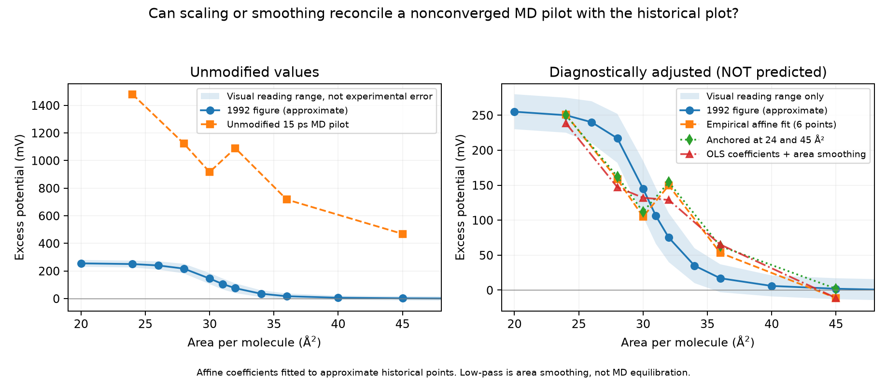

# Can the short molecular-dynamics pilot be reconciled with the 1992 surface-potential curve?

**Research diagnostic, 22 November 2026.** All empirical values here originate from a rough visual reconstruction of Fig. 1 of Oliveira Jr., Taylor and Morgan, *Thin Solid Films* 210/211 (1992), 76–78 (doi:10.1016/0040-6090(92)90172-8), **not raw tabulated experimental measurements**. The computed points come from the 5 ps equilibration + 10 ps production OpenFF/TIP3P neutral-stearic-acid pilot. The experimental conditions, including pH/ionization, differ. The pilot is non-equilibrated and has unstable bulk-water potential plateaus. Accordingly, these transformations are **descriptive sensitivity tests, not corrections establishing model validity**.

## Numerical findings

At the six overlapping model areas (24, 28, 30, 32, 36, 45 Ų), the unmodified MD output has an RMSE of **882 mV** relative to the rough historical trace. An **empirically fitted** global transformation

\[
\Delta V_{\mathrm{affine}} = 0.259045\,\Delta V_{\mathrm{MD}} - 132.555\,\mathrm{mV}
\]

reduces the **in-sample** RMSE to **44.9 mV** (in-sample \(R^2=0.773\)). However, leave-one-area-out cross-validation RMSE rises to **57.3 mV**, and the six samples have neither converged MD uncertainty bars nor independent experimental standard deviations. This is not evidence of predictive accuracy. Setting the transformation using only the two endpoints, 24 and 45 Ų, similarly gives gain 0.2451, offset −112.9 mV, and full-six-point RMSE **45.6 mV**. These figures are a consequence of the adjustable baseline and amplitude, not a derived microscopic mechanism.

A Gaussian low-pass filter *over molecular area* with arbitrarily illustrated bandwidth **2 Ų**, **without refitting** the affine coefficients, reduces that RMSE from 44.9 to **42.0 mV**. This is negligible beside uncontrolled trajectory errors. A low-pass over area is not temporal averaging, does not sample missing states, and can erase the sharp onset that the model is supposed to predict. Its bandwidth must not be optimized against the empirical curve and then represented as a physical prediction.

**Shape mismatch remains:** between 30 and 32 Ų, the historical trace decreases **145 → 75 mV**, whereas MD increases **917 → 1090 mV**. Positive gain plus additive offset preserves this incorrect slope sign. A sufficiently strong smoothing or monotonic projection can conceal it but supplies the experimental monotonic behavior as an assumption rather than deriving it. An approximate graphical trace also cannot support meaningful significance tests for small residual differences.



## What could physically account for the discrepancy?

1. **Electrostatic reference and slab artifacts:** the nominal water plateau is not flat. Recompute complete charge density and far-field plateaus from equilibrated, aligned neutral slabs; examine vacuum thickness, PME/slab corrections and box-size invariance. A **measured numerical correction** inferred from such convergence tests could justify an offset. Fitting an offset to the experimental isotherm cannot.
2. **Force-field polarization and chemistry:** fixed-charge water and OpenFF headgroups may produce incorrect interfacial response. Compare independent water/acid force fields, and polarizable or quantum-chemistry-based benchmarks of headgroup/hydration electrostatics. A uniform scale factor applied **after explicit-water Poisson integration** is not a legitimate dielectric correction: water charge and polarization are already represented and such a factor risks double-counting screening.
3. **Phase coexistence and sampling:** 16 acids per side in a forced near-uniform 4×4 periodic arrangement over 15 ps cannot resolve growth of micron-scale islands or long-lived condensed domains. Expanded-state near-zero voltage may reflect low condensed-domain area fraction. The physically appropriate model is a free-energy-derived coverage/phase mixture, with its fractions constrained independently by pressure-area and Brewster-angle or scattering data, not post-hoc voltage scaling.
4. **Dissociation/pH:** the simulation uses permanently neutral stearic acid; the experimental ultrapure-water description includes a small dissociation fraction and diffuse-layer potential. Test ionization with matched chemistry and explicit counterions; do not add an arbitrary Gouy–Chapman term to an explicitly ion-resolved double layer.
5. **Convergence:** independently initialized replicas, long enough trajectories to sample headgroup and water rearrangements, block averages and propagated confidence intervals are prerequisites before claiming a meaningful shape or statistically evaluating smoothness.

## Reproduction

From the repository root:

```bash
python -m pip install -e '.[plot,test]'
python scripts/reconciliation_diagnostic.py
pytest -q tests/test_reconciliation_diagnostic.py
```

The script writes `figures/reconciliation_diagnostic.png` and `results/reconciliation_diagnostic.json`; the JSON records the fitting coefficients, LOO RMSE, wrong-slope interval, and explicit `validated_molecular_prediction: false`. Both existing input datasets remain unchanged. The strongest **next scientific test** is not another fit, but a converged molecular simulation predicting both electrical and mechanical isotherms with no empirical curve used to choose an onset, gain, offset, or smoothing bandwidth.